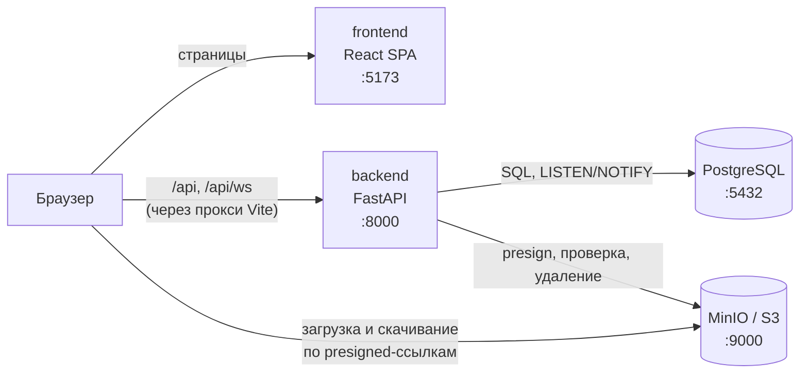
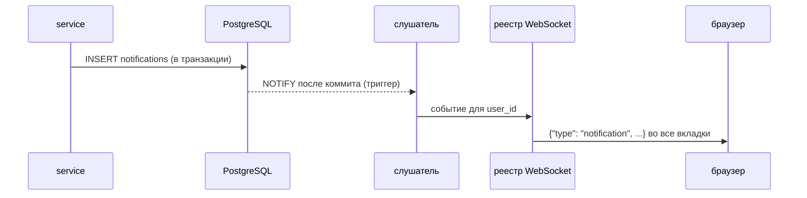

# Архитектура

## Компоненты



| Компонент | Что делает | Где |
|---|---|---|
| frontend | SPA для студента и преподавателя | `frontend/` |
| backend | REST API, WebSocket, админка, напоминания по расписанию | `backend/` |
| PostgreSQL | все данные, триггеры уведомлений | `infra/` |
| MinIO | файлы: материалы, задания, попытки, аватарки | `infra/` |

Всё поднимается в Docker: окружение (`infra/`) создаёт сеть `labka`, backend подключается к ней.
Frontend в разработке запускается через Vite и проксирует `/api` на backend, поэтому приложение и
API живут на одном адресе: cookie работают без CORS.

## Backend

### Слои

```
router  →  service  →  unit of work / repository  →  model
(api/)     (api/)      (core/db/)                    (core/db/models/)
```

- **router** принимает HTTP, проверяет схему запроса (pydantic), вызывает сервис и собирает ответ.
- **service** — бизнес-правила домена: доступ, дедлайны, шкалы, уведомления.
- **unit of work** держит транзакцию; **репозитории** — запросы SQLAlchemy.
- **core** — общие подсистемы, которыми пользуются домены: доступ (`access`), оценки и статусы
  (`grading`), расписание (`schedule`), уведомления, S3, безопасность.

Зависимости идут только вниз. API-домены не импортируют друг друга, `core` не импортирует `api`
(кроме провайдеров `core/di`) — это проверяется тестом. Зависимости собирает контейнер dishka.

### Ошибки

Каждая ошибка — класс с `code` и `message` в `api/exc/<домен>.py`, унаследованный от категории
(`NotFoundError`, `ForbiddenError`, `ConflictError`, …). Единый обработчик
(`api/exc/handler.py`) переводит категорию в HTTP-статус, пишет лог и отдаёт ответ в формате
`{"error": {...}}`. Ошибки БД (нарушение уникальности и т. п.) переводятся в доменные там же, где
выполняется запрос.

### Аутентификация

- Пароли — argon2, длина 8–32 символа.
- Вход создаёт запись в `sessions`. Access-токен (JWT) несёт `user_id` и `session_id`,
  refresh-токен — случайный секрет, в БД хранится его хэш.
- На каждый запрос проверяется, что сессия не отозвана и пользователь активен, поэтому
  деактивация и сброс пароля действуют сразу.
- Админка — отдельная форма входа sqladmin со своей сессией; пускает только роль `admin`.

### Уведомления в реальном времени



- Уведомление сначала сохраняется в БД, поэтому ничего не теряется, даже если пользователь не в сети.
- Отзыв сессии тоже приходит через `NOTIFY`: реестр закрывает её соединения с кодом 4401.
- Если слушатель потерял соединение с БД, после восстановления клиенты получают `resync` и
  перечитывают список.
- Напоминания о дедлайнах создаёт APScheduler раз в 5 минут.

Слушатель, планировщик и реестр соединений живут в памяти процесса, поэтому backend запускается в
одном процессе (`workers=1`).

### Файлы

Backend выдаёт presigned-формы для загрузки и presigned-ссылки для скачивания. Перед сохранением
записи он проверяет, что объект в S3 есть, не больше лимита и лежит под ключом, выданным этому
пользователю. Если запрос отклонён, только что загруженные файлы удаляются из S3. У backend в MinIO
своя учётка с доступом только к объектам бакета.

## Frontend

### Структура

Упрощённый Feature-Sliced Design: слой импортирует только слои ниже себя.

| Слой | Что лежит |
|---|---|
| `app` | точка входа, провайдеры, маршруты и защита по роли, стили |
| `pages` | страницы: собирают экран из блоков ниже |
| `widgets` | каркас приложения (шапка, навигация, подвал), лента курса |
| `features` | действия пользователя: вход, сдача, проверка, редакторы курса, задания, материала, объявления |
| `entities` | сущности: запросы к API и их маленькие UI (бейджи статуса, дедлайн, попытка) |
| `shared` | API-клиент и типы, утилиты, UI-компоненты shadcn/ui |

### Данные

- Типы запросов и ответов генерируются из OpenAPI-схемы backend (`shared/api/schema.d.ts`), клиент —
  `openapi-fetch`. Расхождение полей с API ловит компилятор.
- Данные с сервера кэширует TanStack Query. После изменения нужные запросы инвалидируются, и экран
  показывает свежие данные.
- На 401 клиент один раз обновляет токены и повторяет запрос. Между вкладками обновление идёт по
  очереди (Web Locks): refresh-токен одноразовый.
- Формы — React Hook Form + Zod по тем же правилам, что на сервере; ошибки сервера с полями
  показываются под нужным полем.
- Правила, которые решает сервер (например, можно ли сдать работу — `can_submit`), фронт не
  дублирует.
