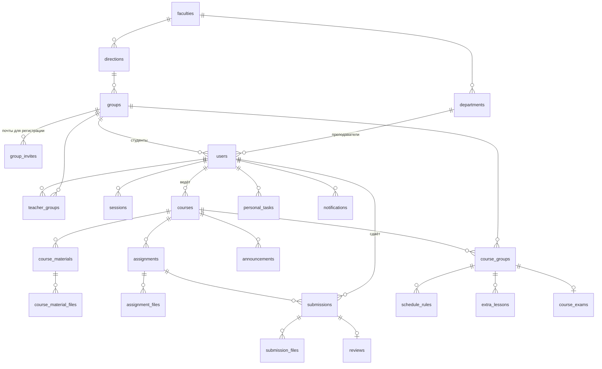

# Модель данных

PostgreSQL 18, модели SQLAlchemy — в `backend/src/core/db/models/`, схема задаётся миграциями Alembic
(`backend/alembic/versions/`). Первичные ключи — UUID v7. Моменты времени хранятся как `timestamptz`, на экранах
показываются по МСК. Перечисления — `VARCHAR` с `CHECK` по допустимым значениям.

## Схема

## Таблицы

### Структура вуза

| Таблица | Поля | Ключи и ограничения |
|---|---|---|
| `faculties` | `name`, `short_name`, `type` (`faculty` / `center`) | `name` уникально |
| `departments` | `faculty_id`, `name` | FK → `faculties`; `(faculty_id, name)` уникальна |
| `directions` | `faculty_id`, `short_name` (`ВТ`), `name` | FK → `faculties`; `short_name` уникально |
| `groups` | `direction_id`, `level` (бакалавриат / специалитет / магистратура), `study_form`, `admission_year`, `number`, `name`, `registration_code_hash`, `is_active` | FK → `directions`; `name` и хэш кода уникальны |

### Пользователи и вход

| Таблица | Поля | Ключи и ограничения |
|---|---|---|
| `users` | ФИО, `email`, `password_hash` (argon2), `role` (`admin` / `teacher` / `student`), `group_id`, `department_id`, `avatar_key`, `is_active` | `email` уникален и в нижнем регистре. У студента есть группа, у преподавателя — кафедра, у администратора — ни того ни другого |
| `group_invites` | `group_id`, `email`, `user_id` | Почта, по которой можно зарегистрироваться в группу; после регистрации ссылается на пользователя. `email` уникален во всех группах |
| `teacher_groups` | `teacher_id`, `group_id` | Составной PK. Группы, которые преподаватель может добавлять в курсы |
| `sessions` | `user_id`, `refresh_token_hash`, `expires_at`, `revoked_at`, `user_agent` | Одна сессия — один вход. Отзыв ставит `revoked_at` |

### Курсы

| Таблица | Поля | Ключи и ограничения |
|---|---|---|
| `courses` | `teacher_id`, `name`, `description`, `term` (`autumn` / `spring`), `year`, `scale_type`, `scale_min`, `scale_max`, `grading_note`, `is_archived` | FK → `users`. Шкала `range` требует `min < max`, `binary` (зачёт) — без границ |
| `course_groups` | `course_id`, `group_id` | Составной PK; удаляется вместе с курсом |
| `course_materials` | `course_id`, `title`, `text` | Текст в Markdown |
| `course_material_files` | `material_id`, `file_key`, `file_name`, `file_size`, `content_type` | `file_key` — ключ объекта в S3, уникален |
| `announcements` | `course_id`, `text` | |

### Задания и проверка

| Таблица | Поля | Ключи и ограничения |
|---|---|---|
| `assignments` | `course_id`, `type` (`lab` / `practice` / `hw`), `title`, `description`, `deadline_type` (`none` / `soft` / `hard`), `deadline_at`, своя шкала (необязательно), `grading_note` | Срок есть тогда и только тогда, когда тип дедлайна не `none`. Без своей шкалы действует шкала курса |
| `assignment_files` | как у файлов материала | |
| `submissions` | `assignment_id`, `student_id`, `number`, `comment`, `is_late` | Попытка студента; `(assignment_id, student_id, number)` уникальна |
| `submission_files` | как у файлов материала | |
| `reviews` | `submission_id`, `verdict` (`accepted` / `revision`), `score`, `is_passed`, `comment` | Одна проверка на попытку. Либо балл, либо «зачтено», не оба; «принято» без оценки не бывает |

### Расписание

| Таблица | Поля | Ключи и ограничения |
|---|---|---|
| `schedule_rules` | `course_id`, `group_id`, `lesson_type` (`lab` / `practice`), `weekday` (1–7), `starts_at`, `ends_at`, `repeat` (`weekly` / `even` / `odd`), `room` | FK `(course_id, group_id)` → `course_groups`: правило есть только у группы курса |
| `extra_lessons` | `course_id`, `group_id`, `lesson_type`, `day`, время, `room` | Разовое занятие; FK как у правил |
| `course_exams` | `course_id`, `group_id`, `exam_type` (`credit` / `graded_credit` / `exam`), `day`, время, `room` | `(course_id, group_id)` уникальна — один экзамен у группы в курсе |

Время занятий и экзаменов совпадает с окнами пар из `[schedule] slots` в `backend/config.toml`.

### Личное

| Таблица | Поля | Ключи и ограничения |
|---|---|---|
| `personal_tasks` | `student_id`, `title`, `due_date`, `due_time`, `is_done` | Видны только владельцу |
| `notifications` | `user_id`, `type`, `data` (JSONB-слепок объекта), `is_read`, `dedup_key` | `dedup_key` склеивает серию правок одного объекта в одно уведомление |

## Что не хранится, а вычисляется

- **Статус студента по заданию** («не сдано», «на проверке», «на доработку», «принято») и **текущая
  оценка** — по попыткам и проверкам.
- **Занятия на конкретные даты** — из правил расписания, семестра курса и чётности недели. Неделя 1 —
  та, на которую приходится начало семестра; она нечётная.
- **Границы семестров** — из `[schedule]` в конфиге: осенний с 1 сентября по 31 января (пары до
  30 декабря), весенний с 1 февраля по 10 июля.

## Удаление

- Курсы не удаляются, а уходят в архив (`is_archived`).
- Удаление задания или материала каскадно удаляет зависимые записи (файлы, попытки, проверки);
  сами файлы удаляет из S3 сервис.
- Пользователей и группы не удаляют, а деактивируют (`is_active`), чтобы сохранить попытки и оценки.
- Элемент структуры вуза, на который ссылаются, удалить нельзя.

## Триггеры

После коммита триггеры PostgreSQL отправляют `NOTIFY` о новом уведомлении и об отзыве сессии. Их
слушает backend и пересылает события в WebSocket (см. [architecture.md](architecture.md)).
